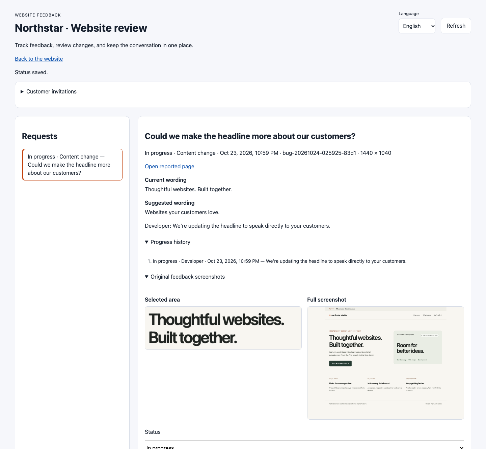
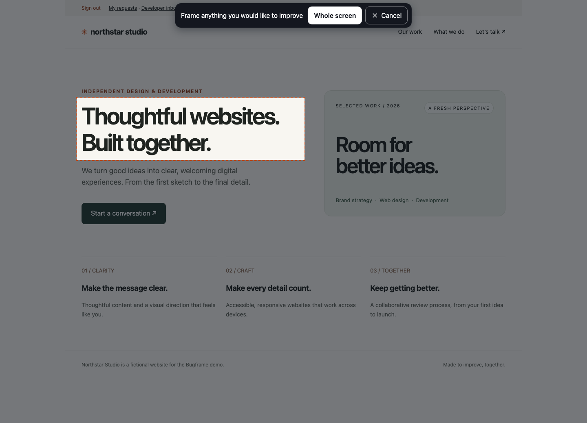
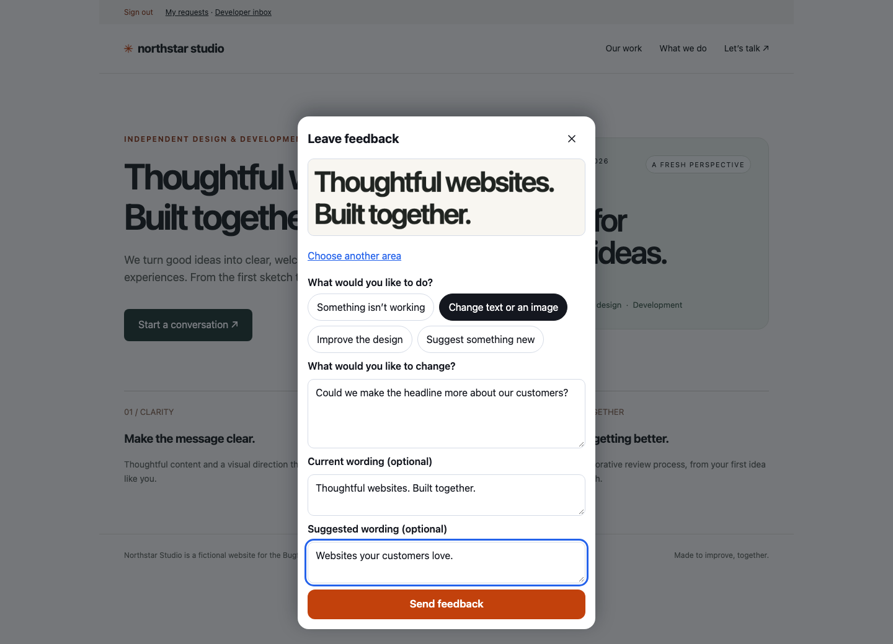
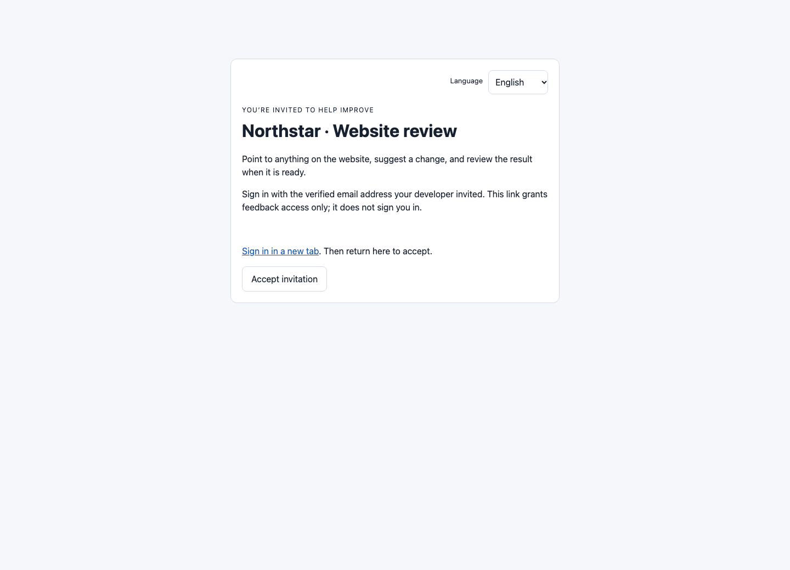
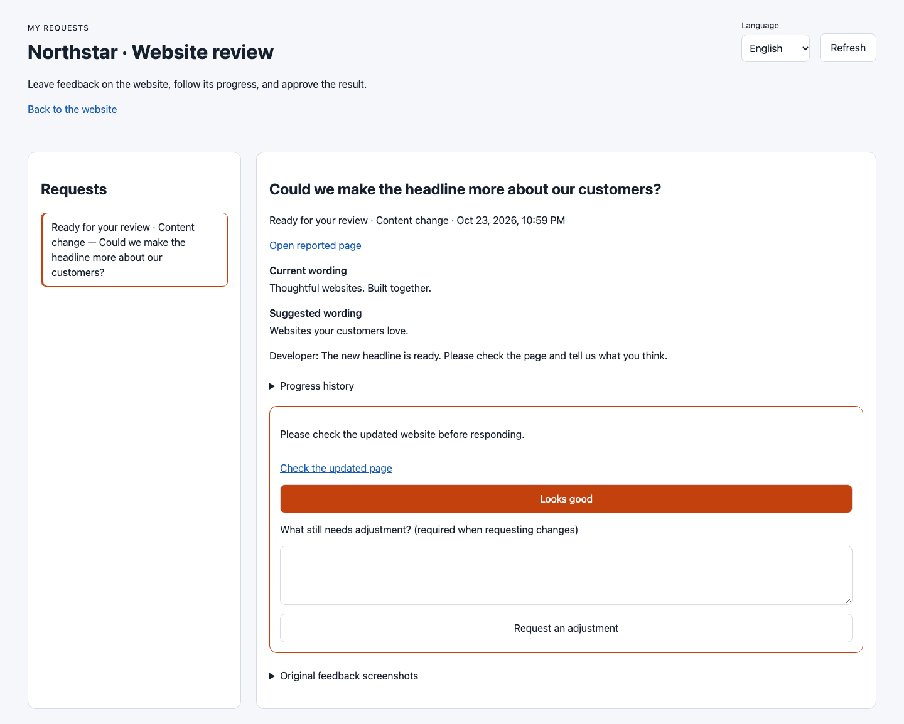
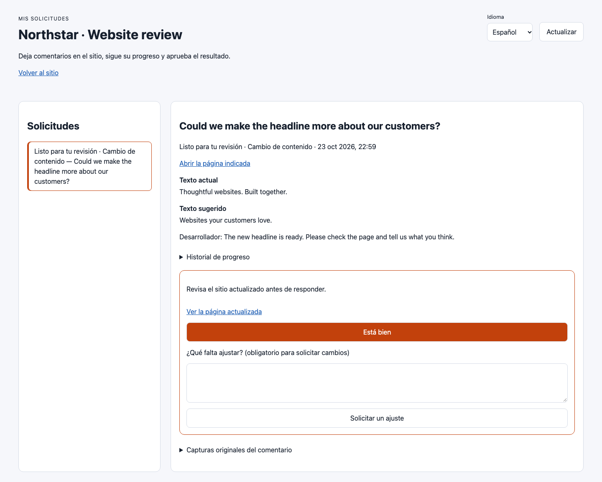
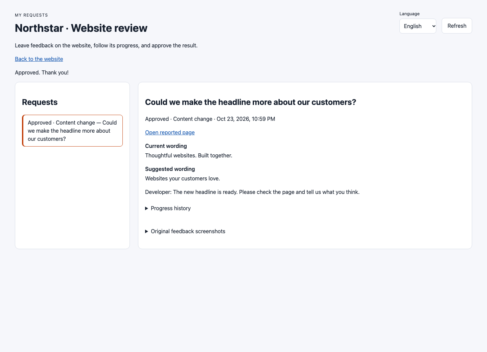

# Bugframe interface screenshots

These images show the actual Bugframe 0.4.1 interface running in Chromium. They replace the earlier AI-generated mockups; no image generation or image editing is used for the current gallery. The Northstar Studio website, customer account, request, and developer notes are fictional demo content. No live accounts, credentials, invitation secrets, or customer reports appear in the images. Code, documentation, and images are available under the repository’s MIT license.

| File | What it shows |
| --- | --- |
| `images/bugframe-overview.png` | Developer inbox with the customer’s content request, original screenshots, progress controls, and technical evidence. |
| `images/frame-the-problem.png` | A customer frames the homepage headline on the sample website. |
| `images/describe-and-send.png` | The four feedback kinds and a content request with current and proposed wording. |
| `images/customer-invitation.png` | Invitation acceptance through an existing verified account. The secret is removed from the browser URL and never rendered. |
| `images/customer-review.png` | English customer view: check the delivered page, approve, or request an adjustment. |
| `images/customer-review-es.png` | The same customer interface in Spanish. |
| `images/customer-review-pt.png` | The same customer interface in Portuguese. |
| `images/customer-approved.png` | Customer-approved result and progress history. |

## Reproduce

From the repository with Node.js 20+:

```bash
npm ci --ignore-scripts
npx playwright install chromium
npm run docs:images
```

The capture script starts an isolated loopback demo with disposable accounts and report storage, signs in through real session flows, accepts an invitation, submits feedback through the real widget, and opens the developer inbox. It updates the fictional headline in a disposable source copy, requests customer review, changes the interface language, and records the approval. It closes Chromium and removes its temporary data afterward. The repository’s demo source is not modified during capture.

The language screenshots intentionally keep the original English customer text and developer note: UI language changes do not translate or alter user-authored content. The example page is also available at `/review-demo?bugs=1` when running `npm run example`.









